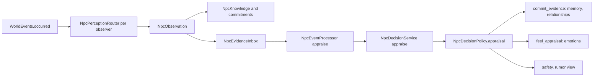
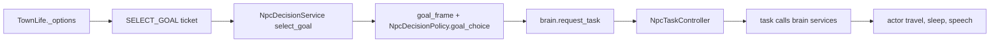

# NPC cognition architecture

How a resident perceives, remembers, decides and acts, who owns each piece of that state, and how to extend or debug it. The design rationale and milestone history live in [the cognition plan](plans/2026-09-21-npc-cognition-architecture.md); this page describes the code as it stands. Related pages: [perception and reactions](npc_perception.md), [memory and dialogue](npc_memory.md), [town life](town_life.md), [testing](godot_testing.md), [dialog server](../tools/server/README.md).

The rule that shapes everything: the backend (Jev for judgments, the dialogue model for words) only answers typed questions. It never applies a relationship change, memory, goal or movement. Godot validates each answer, applies it through one owner, and discards it when the world moved on while it was in flight.

## Ownership

| Concern | Owner | Notes |
| --- | --- | --- |
| Locomotion and body | `BaseActor` / `BaseNpc`, `ActorRoute`, `WorldNavigation` | Tasks never move a body directly; they call brain services such as `travel` |
| What a resident is doing | `NpcBrain` (child node of each town resident) with its `NpcTaskController` | One current task plus at most one suspended task; owner-checked `locomotion` and `conversation` claims |
| Evidence (what was perceived) | `NpcObservation` in the per-mind `NpcEvidenceInbox` | Produced by `NpcCognition._on_world_event` through `NpcPerceptionRouter`; survives provider outages |
| Appraisal of evidence | `NpcEventProcessor` (child of `NpcCognition`) | Asks `NpcDecisionService` for `appraise`, applies the result through `NpcDecisionPolicy.appraisal` and `NpcMemoryStore.commit_evidence` |
| Knowledge (what the resident believes is true) | `NpcKnowledge` in each `NpcMindState` | Attributed facts with provenance; never a copy of world truth. Learned in `NpcCognition` from the same observation |
| Memory (what the resident remembers) | `NpcMemoryStore` | Episodic, semantic, social and prospective records, recent dialogue, working memory. Retrieval is `NpcMemoryRetriever` |
| Relationships | `NpcRelationshipGraph` in each `NpcMindState` | Directed, per subject (residents and `player`). Changes are bounded per incident by `NpcIncidentBudget` |
| Commitments | `NpcCommitments` in each `NpcMindState` | Kinds `report_discovery`, `check_relative`, `attend_obligation`, `visit_grave`; resolved by task outcome (see below) |
| Needs and emotions | `NpcMindState` (`needs`: hunger, fatigue, social; `emotions`: fear, anger, grief, relief) | Emotions come from appraisals (`NpcEventProcessor.feel_appraisal`); needs advance with time |
| Decisions | `NpcDecisionService` (tickets, pools, routes) and `NpcDecisionPolicy` (pure result-to-effect mapping) | `TownLife` builds the goal frame; the policy turns a judgment into a `GoalChoice` |
| Town schedule and goal candidates | `TownLife`, `TownLifeState`, `NpcRoutinePlan` | Place catalog, candidate options, routine tasks |
| Deaths and bodies | `NpcWorldSave.dead_npcs` (authoritative) and `TownDeaths` (recovery stages) | A rumor or a model can never change who is alive |
| Saves | `NpcWorldSave` (format and files) and `NpcSaveCoordinator` (when writes happen) | One atomic v2 file; the coordinator is the only writer |
| Player dialogue | `DialogManager` (UI) and `NpcConversation` (request/commit) | Cognition does not live in the dialogue UI |

`NpcCognition` (Autoload `/root/NpcCognition`) wires these together: `save_game`, `store`, `backend`, `decisions`, `events`, `saves`, `perception` and `ambient`. `TownLife` adds an `NpcBrain` to each resident and holds the town services the brains' tasks call.

## Data flow

### From perception to memory

1. `BaseActor` publishes a `WorldEvent`. `NpcCognition._on_world_event` applies the registered perception adapter to every observer, producing an `NpcObservation` only for what that individual could perceive.
2. `NpcCognition.learn` records sightings and deaths in the resident's personal knowledge, and the same step may open commitments (`check_relative` for a relative's death or injury, `visit_grave` for a known grave). Then `NpcEventProcessor.observe` enqueues the observation in the resident's `NpcEvidenceInbox`.
3. `NpcEventProcessor` serves residents round-robin (at most `MAX_WORKERS` = 2 appraisals at once) and asks the decision service for an `appraise` judgment, stamped with the knowledge, relationship and condition versions it read.
4. On success the policy's `Appraisal` (danger, remember, importance, emotions, bounded relationship deltas) is committed once. On provider failure the evidence is deferred along a real-time retry ladder (2, 10, 30 seconds, then a 60 second backoff) and is never dropped; `NpcCognition._process` calls `retry_deferred_evidence`.
5. Optional speech is separate and only for live arrivals: `utterance` judgment first, then `/v2/dialogue/say`. A reaction older than `REACTION_MAX_AGE_MINUTES` is dropped.

### From goal to movement

1. `TownLife._choose_activity` builds the resident's candidates (`_options`), asks for a `select_goal` judgment with `read_versions` of the life revision, task, condition band and commitments, and awaits it.
2. If any of those changed while the judgment was in flight, or the resident is busy elsewhere (encounter, funeral, safety concern, morning plan), the result is dropped and the resident replans.
3. `TownLife.goal_frame` adds the resident's own reasons (need, obligation, concern, commitment, personality), and `NpcDecisionPolicy.goal_choice` combines them with the judgment. Without a usable judgment, the resident keeps its own priorities or today's plan entry (`schedule_fallback`, `plan_kept`).
4. `_request_routine` turns the winner into an `NpcRoutineTask` and calls `NpcBrain.request_task`. The controller starts it, grants claims, and advances it each simulated minute. The task asks the brain for services; the brain delegates to the town and actor.
5. Safety, guard duty, recovery and conversations enter the same controller as their own task kinds and outrank routines by priority, suspending them.

## Decision service and routes

`NpcDecisionService` is the only caller of the backend for cognition. Callers build an `NpcDecisionTicket` (`NpcDecisionTicket.create(npc_id, kind, urgency)`) and call `evaluate` (judgments) or `chat` (player dialogue); words for ambient speech go through `run_text`. Every ticket carries the evidence ids, candidate ids and the versions it read.

| Ticket kind | Route | Used by |
| --- | --- | --- |
| `APPRAISE` | `POST /v2/cognition/appraise` | `NpcEventProcessor` |
| `SELECT_GOAL` | `POST /v2/cognition/select-goal` | `TownLife._choose_activity` |
| `SOCIAL` | `POST /v2/cognition/social` | `TownEncounters` |
| `LISTEN` | `POST /v2/cognition/listen` | `TownEncounters` |
| `UTTERANCE` | `POST /v2/cognition/utterance` | speech decisions |
| `DIALOGUE` | `POST /v2/dialogue/chat` | `NpcConversation` |
| (text only) | `POST /v2/dialogue/say` | ambient and NPC-to-NPC lines |

- Concurrency: judgments use a pool of 4 and texts a pool of 2 (`NpcDecisionService.LIMITS`), with one slot reserved for `INTERACTIVE` urgency and aging after `AGING_MSEC` so background work cannot starve. `Urgency` is `INTERACTIVE`, `SAFETY` or `BACKGROUND`.
- Protocol: `PROTOCOL_VERSION` 2 and `PROMPT_VERSION` `cognition-1` travel on every request; the server answers `409 protocol_mismatch` otherwise.
- Outcomes (`NpcDecisionResult.Outcome`): `SUCCESS`, `UNAVAILABLE`, `TIMEOUT`, `INVALID`, `CANCELLED`, `STALE`. Anything but `SUCCESS` leaves the resident on its own priorities; a service failure never fabricates a decision, conversation or memory. A newer `SELECT_GOAL` for the same resident turns the older queued one `STALE`.
- The old v1 routes (`/decide`, `/chat`, `/react`, `/observe`, `/life/*`) no longer exist. Restart the backend after updating it; an outdated server answers 404 or 409 and the game falls back as above.
- The server contract (envelope, limits such as at most 8 candidates per `select_goal`, deadlines) is in [tools/server/README.md](../tools/server/README.md).

## Saving

`NpcWorldSave` owns the file format; `NpcSaveCoordinator` (child `Saves` of `NpcCognition`, also `NpcCognition.saves`) owns when it is written. Nothing else calls `save_file()`.

- `request(reason)` coalesces: the write happens `DEBOUNCE_MSEC` (2000) after the latest request, never later than `MAX_PENDING_MSEC` (10000) after the first unsaved change.
- `flush(reason)` writes at once and cancels the pending write. Critical transitions flush: `&"death"`, `&"scene_exit"`, `&"body_settled"`, `&"funeral_stage"`, `&"region_seed"`. Routine changes request: for example `&"world_event"`, `&"observation_assessed"`, `&"player_exchange"`, `&"social_exchange"`, `&"routine_planned"`, `&"hourly_upkeep"`, `&"town_ready"` and `&"safety_task"`.
- `add_snapshot_hook(callable)` runs right before each write so live state lands in the same coherent file. `TownLife` uses one to store positions and each brain's `save_checkpoint()`.
- Counters for diagnosing saves: `writes`, `bytes_last`, `bytes_total`, `requests`, `coalesced`, `failures`, `last_status`, `last_reason`; `write_failed(reason, error)` is emitted after a failed write.
- `NpcWorldSave.save_file` writes `<path>.tmp` and renames it over the save. A failed write leaves the previous file intact and the game running in memory.

### File and migration

The current save is `user://npc_world_v2.json` (`NpcWorldSave.SAVE_VERSION` 2) with root keys `version`, `migration`, `world`, `minds`, `memory`. `world` holds `dead_npcs`, seeds, `life`, `population`, `economy`, `justice` and `deaths`; `minds` holds the per-resident `NpcMindState` data.

`NpcSaveMigration.upgrade` is a pure function from an older root to the current root; `NpcWorldSave.load_file` does the file work. The `migration` record `{source_version, source_digest, revision}` says where the world came from (`source_version` 0 new, 1 v1 world file, 100 memory-only file) and the SHA-256 of the source text. The current `NpcSaveMigration.REVISION` is 3:

| Revision | Adds |
| --- | --- |
| 1 | The v2 shape. v1 `ties` and each memory state's player relationship become directed relationships per mind; the saved goal record keeps only the `commitment_id` it serves; a memory-only file is wrapped as a v2 world around its memory state |
| 2 | Per-mind `knowledge` and `evidence` inbox. Memory observations still pending or unavailable become inbox evidence (unavailable ones deferred, `last_error` `legacy_unavailable`). A fighting-sounds cue that only a misclassified v1 report had added is removed |
| 3 | Session fields on dialogue and social history. Legacy entries get `session_id` `legacy`; legacy dialogue has no time (minute -1) and every legacy line counts as delivered; social entries gain `speaker_id`/`listener_id` from the owner and `with` |

What is preserved: v1 memories, recent dialogue, ties (as relationships), prospective intentions, the world sections (`life`, `population`, `economy`, `justice`, `deaths`), `dead_npcs` and the region and NPC seeds. What is not invented: memories with no recorded world date stay undated (`NpcMemory.UNKNOWN_MINUTE`, -1; `date_known` false); they age from the moment of loading (`age_anchor_minute`) and never receive a made-up date. Corrupt, unsupported or future-revision files are reported and writes stay disabled (`ERR_FILE_CORRUPT`); the live state is unchanged and the file is never replaced.

## Recipe: add a goal or task

A new behavior crosses one boundary: an `NpcTask` subclass, plus one candidate option and its goal-frame reasons. The decision service, save format and actor states do not change. The routine task (`game/actors/npcs/tasks/npc_routine_task.gd`) is the model to copy; guard and recovery tasks show tasks with town services.

1. **Write the task.** Create `game/actors/npcs/tasks/npc_<name>_task.gd`, `class_name Npc<Name>Task extends NpcTask`, with a static `create(params, tuning, id = "")` like `NpcRoutineTask.create`. Set `kind` in `_init()`. Override:
   - `_validate_params(params)` for the saved parameter shape (checkpoints restore through it, so params must be JSON-compatible);
   - `_on_start(context)`, `_on_advance(context, minutes)` returning `NpcTaskResult.running()`, `completed(reason)` or `failed(reason)`;
   - `_on_suspend`, `_on_resume`, `_on_cancel` to release what the task holds (for example `context.call_service(&"cancel_travel", [task_id])` for travel);
   - `_interrupt_response(interrupt)` to decide whether a danger, sleep or conversation interrupt cancels, suspends or ignores the task;
   - `required_claims()` when it needs `locomotion` or `conversation`, and `_revalidate(context)` if the world can invalidate it.
   Reach the body only through `context.call_service(...)` (`travel`, `travel_state`, `bed`, `space`, `sleep`, `wake`, `can_move`, ...). A town-specific service is supplied with `NpcBrain.provide_service`, as `TownWatch` and `TownFunerals` do. Measure time in world minutes from `_on_advance`, not real seconds.
2. **Register the kind.** Add `controller.register_kind(&"<kind>", Npc<Name>Task)` next to the existing five (`routine`, `safety`, `social`, `guard`, `recovery`) in `NpcBrain.setup` (`game/actors/npcs/cognition/npc_brain.gd`). A kind that is not registered cannot be restored from a save.
3. **Make it a candidate.** For a scheduled or optional activity, add an option in `TownLife._options` with `_add_option(options, ID, kind, place, reason)`. The `id` is the candidate id the backend sees (a valid id, at most 8 candidates per request, a unique non-empty description). `TownLife.destination` resolves the place to a space and point. For an obligation raised by evidence, open a commitment instead (below) and add it from `_add_commitment_options`.
4. **Give it reasons.** In `TownLife.goal_frame` map the option's `kind` to the components it should respond to: a need (`hunger`, `fatigue`, `social`), an obligation, a concern from current emotion causes, a commitment priority and a personality trait. The weights are the `goal_*_weight` fields of `NpcBehaviorTuning`. No change is needed in `NpcDecisionPolicy.goal_choice` or the server: it scores whatever candidates and frame it is given.
5. **Start it.** Routines start through `TownLife._request_routine` (`brain.request_task(...)`); duty-like behavior is started by its own adapter (`TownWatch`, `TownFunerals`). Set `priority` so the task displaces only what it should; safety outranks routine, and tasks at or above `NpcTaskController.URGENT_PRIORITY` take claims from sessions.
6. **Show it.** If the new kind should change what the resident appears to do, extend `TownLife._show_activity`, which projects the running task onto `NpcDailyRoutine.activity` and `place` (gait, work accounting and dialogue context follow from these).
7. **Link commitments (optional).** Create one with `NpcCommitments.create(kind, other_ids, evidence_ids, created_minute, deadline_minute, priority)` and put its id in the task's `commitment_ids` before `request_task`. `NpcBrain` resolves it from the task's outcome: `completed` when the task completes, `failed` when it fails or the deadline has passed, `cancelled` when the task cannot be restored (`restore_invalid`). A plain cancel leaves it open for its owner to re-request.
8. **Prospective memories.** Model prose never completes an intention. A completed commitment whose `evidence_ids` contains `memory:<memory id>` makes the brain call `NpcMemoryStore.complete_intention(npc_id, memory_id)`. There is no direct call from game code for this. No shipped system creates such a commitment yet; `tests/integration/npc_cognition_matrix_test.gd` (row 13) shows the flow: `commitments.create("report_discovery", [], ["memory:" + id], minute)` and the id in the task's `commitment_ids`.
9. **Test it.** Add `tests/unit/npc_<name>_task_test.gd` (model: `npc_routine_task_test.gd`, `npc_guard_task_test.gd`), a case in `npc_goal_selection_test.gd` if the frame changed, a `npc_commitment_test.gd` case if it resolves a commitment, and a checkpoint round trip. Use `tests/fixtures/npc_simulation_fixture.gd` and `npc_fake_decision_service.gd` for a scenario in `tests/integration/npc_cognition_scenarios_test.gd`. Run the commands in [godot_testing.md](godot_testing.md).

## Recipe: inspect a stuck resident

In debug builds only: run the game from the editor, switch the Scene dock to **Remote**, select the resident node, and expand the **Cognition** group. Properties are read-only copies named `runtime_cognition_<field>`, rebuilt only when the mind, brain, trace, task, claims or condition changed.

| Field | Question it answers |
| --- | --- |
| `current_task`, `suspended_task` | What is running now? Check `kind`, `phase`, `status`, `started_minute`, `deadline_minute`, `params` (progress is omitted) |
| `claims` | Who holds `locomotion` and `conversation`? A claim held by a dead session or stale task id blocks movement |
| `goal_scores` | The latest goal decision: `reason` (`jev`, `priority`, `plan_kept`, `schedule_fallback`, `scheduled_wakeup`), `selected`, `duration`, `request_id`, and per candidate the score components (`suitability`, `need`, `obligation`, `concern`, `commitment`, `personality`, `switching`, `total`, `eligible`) |
| `request_outcomes` | The latest decision requests and their `outcome` (`SUCCESS`, `UNAVAILABLE`, `TIMEOUT`, `INVALID`, `CANCELLED`, `STALE`) |
| `trace` | The last 64 entries (`NpcDecisionTrace.CAPACITY`), kinds `goal`, `transition`, `request`, `effect` (commitment outcomes) and `save_failure` |
| `commitments` | Open commitments, their kind, subject, priority, deadline and linked task |
| `pending_evidence` | `by_status` counts of inbox items and the receipt count. Many `DEFERRED` means the provider is failing |
| `condition`, `relationships`, `knowledge_sources`, `perceived_threats` | Needs, emotions, bands and causes; directed feelings; newest personal knowledge; safety concern, alert reflex or enforcement target |
| `last_save_status`, `last_save_failure` | `status`, `reason`, `writes`, `failures`, `bytes_last` of the coordinator; the latest `save_failure` trace entry |

Reading it:

- **Standing still with a task `RUNNING` in phase `travel`.** Compare `claims.locomotion` with the task id, and read `runtime_life` (the **Town Life** group) for the destination and position. A `FAILED` routine whose place was unreachable counts as searched (`TownLife._search_failed`).
- **No task and nothing in `trace`.** The resident is not due for a routine (a safety task, session, duty or funeral blocks it) or its decision keeps coming back `STALE`. Look at `request_outcomes` and `goal_scores.reason`.
- **Repeating `plan_kept` or `schedule_fallback`.** The backend is unavailable or returning invalid answers: check the server log and `pending_evidence`.
- **A task that never finishes.** Check its `deadline_minute` against the world clock in `runtime_life` and whether a commitment is still `open` with that `task_id`.
- **Not saving.** `last_save_status.failures` rising with `status` not `0` means writes fail (disk or a corrupt-source lock); the `save_failure` trace entry names the reason.

In scripts, `NpcBrain.of(npc)` returns the resident's brain; `brain.controller.transitions()` lists recent task transitions (up to 64) and `brain.trace.entries()` the decision trace. `NpcCognition.saves.status()` summarizes the coordinator.

## Recipe: restore a legacy save

Load resolution (`NpcWorldSave.load_file`): `user://npc_world_v2.json`, else the v1 world file `user://npc_world.json`, else the memory-only file `user://npc_memory.json`, else a new world. The legacy files are only ever read, never written, renamed or deleted. The migrated state is written to the v2 path by the first coordinator write after load.

- **Normal upgrade.** With only legacy files present, start the game. `migration.source_version` records 1 (world file) or 100 (memory-only), `source_digest` the source file's SHA-256, and `revision` the current revision.
- **A v2 file exists but you want to migrate from the legacy file again.** Stop the game and move `npc_world_v2.json` aside (keep it; it may hold newer progress). The next start migrates from `npc_world.json` (or `npc_memory.json`). Progress after the original migration is lost by design.
- **A save will not load.** The game logs a warning (`NPC memory save could not be loaded`) and disables writes so the broken file is not overwritten. `upgrade` reports why: `invalid_source`, `future_revision`, `unsupported_version` or `invalid_candidate`. Fix or replace the file; a `future_revision` save needs a newer build.
- **Fresh world.** With the game stopped: `"$GODOT" --headless --path . --script res://tools/reset_npc_world.gd -- --confirm`, optionally with `--keep-region` (retain the forest seed) and `--reroll-npcs` (new NPC seed: personalities, relationships and routines regenerate). It backs up the current v2 save to `npc_world_v2.json.reset-<unix time>.bak` and leaves legacy files untouched.

Fixtures for every legacy shape (empty, deaths, observations, prospective intentions, rumors, a rerolled town, memory-only, future-version, invalid) are in `tests/fixtures/cognition/` and are exercised by `tests/unit/npc_legacy_fixture_test.gd` and `tests/unit/npc_save_migration_test.gd`.

## Checks

- Unit runner: `./tools/run_godot_tests.sh` (all of `tests/unit`); `ARCADIA_TEST_FILTER=npc_brain` focuses it.
- Cognition check runner: `tools/run_npc_cognition_checks.sh` (`.ps1` on Windows) runs the full unit runner, the town/actor integration scripts, the cognition matrix, soak and runtime smoke scripts, and the backend tests (including the mocked evaluator run) in one command.
- Integration scripts (run with `--script`, see [godot_testing.md](godot_testing.md)):
  - `npc_cognition_scenarios_test`: save isolation, reload stability, no information without evidence, personal knowledge, routine goal choice, sleepers, safety sessions, reload mid-travel, crossing invitations and player takeover of a session.
  - `npc_cognition_matrix_test`: acceptance-matrix rows 7 (unknown guard location), 13 (promise and farewell), 14 (family news), 15 (a repeated rumor), 19 (save and reload at every recovery phase) and 20 (same seed, same goals).
  - `npc_cognition_soak_test`: a long simulated run that checks save size growth and bounded queues and counters.
  - `npc_runtime_smoke_test`: the autoload, scene and save boundary start together and run briefly.
- Backend: `cd tools/server && npm test`, and `npm --prefix tools/server run evaluate -- --mock` for the offline labeled-case evaluation. The live evaluation (`--live --limit N --yes`) spends provider requests and is opt-in only.
