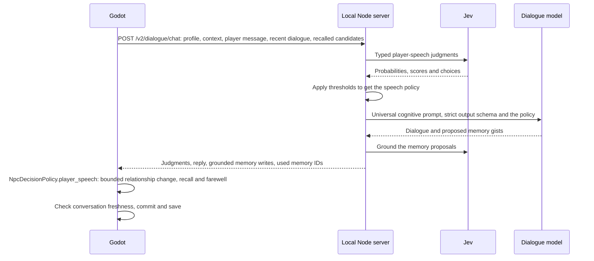

# NPC memory and Jev decisions

This implements the memory design from the [Designing NPC Memory System conversation](https://chatgpt.com/c/58a2744a-5150-832c-993b-6a294513fd10), including its later Arcadia-specific decision to keep saves in Godot. Jev supplies typed judgments; game code owns changes; OpenAI generates dialogue and proposed memory text.

## Ownership and turn flow

`NpcProfile` is immutable authored identity. `NpcMemoryStore` owns save-specific experiences, recent dialogue and pending observed events; relationships, knowledge, commitments and unappraised evidence live in each resident's `NpcMindState` (see the [cognition architecture](npc_cognition_architecture.md)). `NpcConversation` constructs temporary context, sends one `POST /v2/dialogue/chat` request through `NpcDecisionService`, and commits successful exchanges. `DialogManager` owns the helper and UI lifecycle, not memory algorithms. There is no extra Autoload or server database.



The speech policy affects the current response, but persistent state changes only after valid dialogue returns. Closing, switching, reopening, or losing the source invalidates pending results (`NpcConversation.cancel` abandons the request). Failed or unavailable requests do not advance memory time, reinforce recall, consume events or change relationships. A response cannot apply to a later conversation with the same NPC.

Opening an interaction automatically chooses a short player greeting from `NpcConversation.OPENING_GREETINGS`, such as "Hi." or "Hey." The same greeting reaches Jev, the dialogue model and recent history; typed player messages (the free chat line) remain unchanged. NPC responses contain spoken words only. The prompt asks for natural conversational language, and the server replaces any remaining em dashes in displayed responses.

## Authoring NPCs

Give each individual an explicit, unique `NpcProfile.npc_id`. Renaming the display name must not change it. Multiple scene instances with the same ID represent the same person; distinct people need separate profiles/IDs. All nine existing human profiles have IDs.

Profiles compose these resources:

- `NpcKnowledgePack`: reusable knowledge plus explicit expertise limits. All current humans share Rekala knowledge and have a profession pack.
- `NpcCognitionProfile`: attention, factual/social/name recall, emotional retention and sensory association. The alchemist, social trades and practical crafts have different values.
- `NpcCoreMemory`: authored gist, stable memory ID, age, importance, emotion, vividness, confidence, retrieval cues, remembered details and known gaps. Blacksmith, alchemist and tailor include examples.

Keep gists broad. Put precise facts in `important_details` and `weak_details`; these are removed from context as recall weakens. `known_gaps` describes missing information, not the hidden answer. `people` must list names that should be filtered when name recall is weak. Sensory cues are actual remembered sensations, not invented atmospheric decoration.

Old `NpcProfile.memories` strings are imported once as legacy episodic records. They are never sent wholesale as profile fields. Authored records are copied when a save first encounters that NPC, so later authoring edits do not overwrite that save's experiences.

## Memory and belief rules

Runtime records are JSON-compatible dictionaries, not mutable shared Resources:

| Type | Meaning |
| --- | --- |
| episodic | An experienced event or the experience of hearing a claim |
| semantic | A provisional belief admitted by the belief gate |
| social | A supported impression about someone |
| prospective | A promise or unresolved intention |

The last 12 speaker turns form recent dialogue. Ordinary greetings and small talk normally remain there without durable admission. Semantic memory requires Jev's belief gate. Player claims retain `source: player_claim` and belief confidence 0.6; even a believed claim does not become authoritative world state. Different NPCs can retain conflicting beliefs. Exact repeated gists from the same source are deduplicated without increasing confidence.

The dialogue model proposes text and categories but cannot choose trust deltas, importance, belief admission or save IDs. The server grounds each proposed memory in a separate judgment against the current message, the NPC response and the supplied observed events, and returns only the proposals that pass (`memory_writes`); Godot still decides admission through `NpcDecisionPolicy.player_speech` and `NpcMemoryStore.commit_exchange`. This checks grounding and source attribution; it cannot prove that a generated paraphrase is semantically correct. Evaluate that behavior with live models before shipping.

Relationship dimensions remain independent: familiarity, trust, respect, affection, fear and suspicion. Jev selects direction; code applies a bounded magnitude derived from importance. Uncertain choices leave dispositions unchanged. Forgiveness does not delete history. Core identity and procedural expertise remain in authored data.

## Retrieval and forgetting

Retrieval uses normalized word overlap, entities, importance, emotion, recency, rehearsal, sensory cues and unresolved intentions. It returns at most six records with deterministic tie-breaking. No vector database is needed.

Recall separately computes quality using age, cognition, emotional retention, vividness, repetition and matching sensations. Tiers are familiarity, fragmentary, fuzzy, clear and vivid. Weak tiers omit the gist or precise details; names have a separate recall threshold. The LLM receives only the resulting view, never the hidden details with an instruction to pretend it forgot them. Missing information remains absent even when the player repeatedly asks.

Only supplied memories reported as actually used receive rehearsal credit. Emotional memories can keep fragments longer; associative cues can retrieve a memory without a direct question. Saved records remain intact. There is no random rewriting of world facts and no forced confabulation.

Memory age follows the **world clock**: `NpcMemoryStore.world_minute` is set from the town simulation (`set_world_minute`), and retrieval and forgetting use it. `NpcMemoryStore.turn` is only a sequence number that each successful exchange or appraised evidence advances (`advance_time`); it is not a time unit. `NpcCoreMemory.age_turns` is an authoring unit for how long ago an authored memory happened, not a claim that one turn equals a day. Memories imported from a legacy save without a recorded date are marked undated (`NpcMemory.UNKNOWN_MINUTE`) and age from the moment they are loaded. Sleep consolidation, embedding retrieval, learned distortions and NPC-to-NPC gossip are later extensions, not simulated implicitly.

## Perception and intentions

`BaseNpc.get_cognitive_context()` supplies current location, activity, physical condition and sensory cues. Override it for a specific actor to add only things they can perceive. `BaseNpc.take_damage()` records an injury without inventing an attacker identity.

Other game systems can call:

```gdscript
DialogManager.record_npc_event(npc.get_npc_profile(), "I watched the player return my tools.")
```

Pending events are bounded to eight and consumed only after a successful exchange. Events that arrive during a request are preserved for a later exchange. Player assertions must stay player messages; never feed them through this observation API.

Game code, not model prose, resolves a prospective record, and it does so through a commitment. A commitment (`NpcCommitments.create(kind, other_ids, evidence_ids, created_minute, deadline_minute, priority)`) that cites the memory as evidence `memory:<memory id>` is attached to the task that fulfils it (`task.commitment_ids`). `NpcBrain` resolves commitments from the task outcome: `completed` when the task completes, `failed` when it fails or its deadline passes, `cancelled` when it cannot be restored. Only a `completed` commitment calls `NpcMemoryStore.complete_intention(npc_id, memory_id)` for each `memory:` evidence id, which marks the prospective record completed. A cancelled, failed or merely interrupted task leaves the promise open, and nothing else (no model answer, no direct game call) completes it. The flow is exercised by `tests/integration/npc_cognition_matrix_test.gd` (row 13: promise, errand, completion) and `tests/unit/npc_commitment_test.gd`.

This changes the NPC's intention record, never inventory, quests or other world truth. No shipped system creates a promise commitment yet; generic world event simulation and a quest system are outside this change.

## Persistence

The memory records are the `memory` section of the combined save `user://npc_world_v2.json` (`NpcWorldSave`, version 2; see [the cognition architecture](npc_cognition_architecture.md#saving)). `NpcSaveCoordinator` is the only writer: successful exchanges, appraised evidence and observed events request a debounced write, and critical changes flush. Writes go through a temporary file and rename. Loading validates the entire save before replacing state. Invalid or unsupported saves are left untouched and writes are disabled; memory can continue in RAM while the file is recovered. Warnings report persistence errors.

The legacy `user://npc_memory.json` (version 1) and `user://npc_world.json` are only read, never written, when no v2 file exists. `NpcMemoryStore.to_save_data()` and `from_save_data(data, at_minute)` are the store's contract with `NpcWorldSave`. This default is one local playthrough; a future new-game/save-slot UI should own separate `NpcWorldSave` instances or embed this data in its own slot. No multiplayer identity or server-side persistence is implied.

## Inspecting runtime memory

Run the game from Godot, switch the Scene dock to **Remote**, and select the NPC actor node. Expand **Runtime Memory** on the node itself, outside **Npc Data > Profile**. Restart a game that was already running when this feature was added.

The read-only section shows the stable NPC ID, initialization status, global memory turn, full memory records, recent dialogue, pending observed events and the observation diagnostics. Expand the **Memories** array and each record dictionary to see its gist, source, importance, confidence, details and rehearsal data. Values are read from the live store whenever the Remote Inspector refreshes. This debug view includes the full archive; dialogue generation still receives only filtered recall. Relationships, commitments, evidence, tasks and decisions are in the separate **Cognition** group; see [the cognition architecture](npc_cognition_architecture.md#recipe-inspect-a-stuck-resident).

An untouched NPC can show **Not initialized yet.** Inspecting it does not initialize or change its save state. The profile's **Core Memories** and legacy **Memories** fields remain authored inputs. Runtime inspection returns copies, is available only in debug builds, and never serializes these properties into scenes.

## Jev configuration and validation

The [official TypeSafe skill](https://github.com/typesafe-ai/skills) and [API contract](https://docs.typesafe.ai/api) guide the integration. Questions and thresholds are in `tools/server/src/npc-decisions.js`. Noul is a yes-probability; Choice is a categorical decision with confidence; Score is a probability-weighted **zero-based** level. Five importance levels are normalized from 0–4 to 0–1. Raw answers remain available during the exchange.

Initial gates: admission 0.7, retrieval 0.5, belief update 0.8, Choice confidence 0.65. These are tunable starting policies, not measured game-domain calibration. Jev receives current state and recent context before retrieval; it does not receive the full archive. Its pre-response admission gate evaluates the input interaction, so an unsolicited promise first invented by the dialogue model is not automatically admitted when that gate is closed.

Use [server setup](../tools/server/README.md) for credentials and the dialogue model. All automated inference tests use mocks. Godot tests cover isolation, admission, recall, aging, repetition, names, persistence and cancellation; the Node suite exercises the official SDK shape, policy and actual Godot-to-server HTTP flow. Live inference behavior, latency, and thresholds remain to be evaluated after local key configuration.

## Validation notes (2026-09-20)

Validated with Godot 4.7.1 and Node 24.19.0. All 18 changed/new GDScript files passed script checks, the game passed the headless smoke test, and all 10 Node tests passed with `GODOT` set (including the real HTTP client with mocked providers). The Godot suite passed 62/63 tests; all 21 new memory/conversation tests passed.

The existing `npc_ai_test.gd::test_lateral_attack_position_respects_soft_collision_distance` also fails on untouched master `c9d3b4a` under 4.7.1 (43/44 tests). Its attack-distance implementation was left unchanged. Separately, `npm audit` reports existing low/moderate advisories in `body-parser` and `qs`; adding the TypeSafe SDK did not change either locked dependency. Those maintenance issues need a separate review.

The headless editor import also emits existing inventory `@tool`/placeholder-instance errors on both untouched master and this branch; the runtime game smoke test is clean. The sandbox cannot write the editor's global settings file, so validation logs were directed to `/tmp`.

## World-state persistence update

The running game uses `NpcCognition` to own cognition independently of dialogue UI. `user://npc_world_v2.json` stores memories, minds and named-NPC deaths atomically; `npc_world.json` and `npc_memory.json` are legacy import sources. See [NPC perception and persistence](npc_perception.md) for event adapters, live reaction diagnostics and the explicit reset command, and the [cognition architecture](npc_cognition_architecture.md) for ownership, the decision service, migration and recipes.
